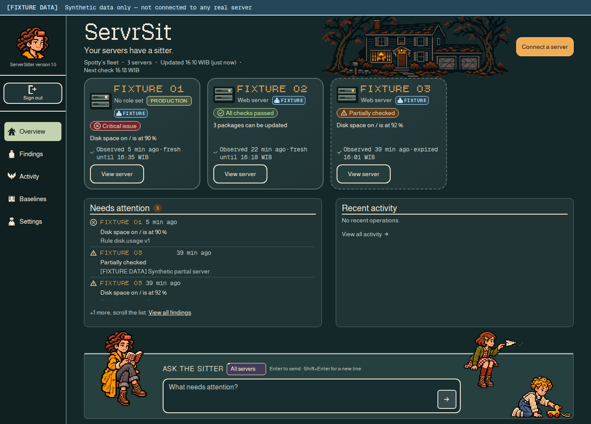
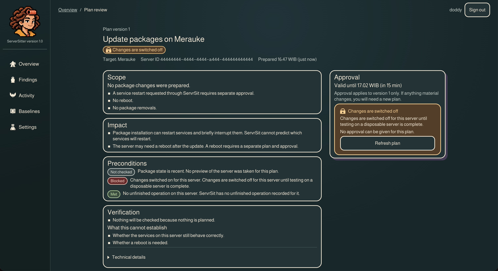
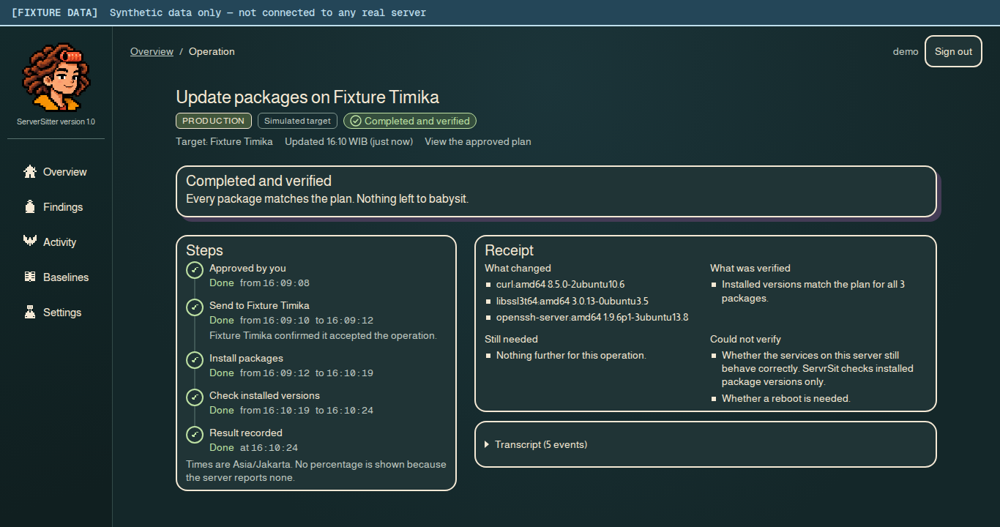

# ServrSit


**Your servers have a sitter. Less babysitting, more building.**

ServrSit was built from the ground up with Kiro agents.

## A home for your agents

In the agentic era, one person can keep several agents working around the clock. One runs tests, another writes docs, and a third works through a backlog. They can work together on one server or run independently on separate machines and hand work to each other. There's usually a job for one more.

You close your laptop at night and take it with you when you leave. Agents that need to keep working when the lid is shut need a home that stays on. That could be a rented cloud server, a remote machine you own, or a mini PC on a shelf at home.

Soon you're keeping track of what every agent is doing while also dealing with full disks, failed services, and pending updates on the machines they live on. **That's when you hire a ServerSitter.**

ServrSit is a caretaker for a small fleet of Ubuntu servers (about 2 to 20), for people who need servers but don't want to spend their time administering them. It checks your machines, explains what it found in plain language, proposes maintenance, and makes changes only after you approve them, then verifies the result.

> **Status: founder alpha, in development.** Not ready for other users. It runs privately on the founder's own machines. Changes are enabled on one disposable test server only.

## See ServrSit in action

The screens below use labeled sample data.

### Fleet overview

See which servers need attention, when they were last checked, and where to ask Millie about the fleet.



### Review an update

Review the target, package list, impact, and verification steps before approving the plan.



### Verify the result

The operation timeline shows when the update ran and when the installed versions were checked. In a separate live test, ServrSit verified all 12 approved package versions on a disposable Ubuntu server.



## What it does

The core loop is **inspect, explain, propose, approve, execute, verify.**

- **Inspect.** Read-only checks over SSH: OS, uptime, load, memory, disk and inode use, failed services, pending updates, reboot-required, clock skew. Every result shows how fresh it is; stale or missing data is never shown as healthy.
- **Explain.** An AI assistant answers questions like "How's everyone?" from the latest checks. Every number it states is checked against the real data, and the reply is withheld if they don't match. The AI cannot run, approve or change anything.
- **Propose.** Maintenance becomes a reviewable plan: exact packages and versions, impact, what will be verified, and a 15-minute expiry.
- **Approve.** You approve one specific plan for one server. Chat replies like "yes, do it" never count as approval.
- **Execute.** A small restricted helper on the server applies exactly the approved change. It accepts only signed requests and refuses replays, holds, locks, and changes outside the plan. Package installation can restart services. A service restart requested through ServrSit requires a separate approval.
- **Verify.** Installed versions are checked independently afterwards. "Command finished" is not treated as "verified".

It also keeps a history of every check and operation (with export), tracks findings you can acknowledge or snooze, and compares servers against a baseline.

## The Bellroad crew

The house on Bellroad got its first server when an agent needed somewhere to finish a job overnight. The spare computer went under the stairs. A second soon followed, and three neighbors started taking turns checking on them.

| Character | Backstory |
| --- | --- |
|  | **Millie** was the neighbor everyone trusted with a spare key. Now she makes her rounds with a lantern and a notebook. Her first question is always, “When did we last see it working?” |
|  | **Otis** built the first server shelf after his toy duck slid off a crooked stack of blocks. He measures everything twice now. The duck supervises. |
|  | **Agnes** used to fly paper planes over the garden fence to share the neighborhood news. Now she pins each check to the kitchen corkboard and saves her best planes for messages Millie needs to see right away. |

## Safety model, briefly

- AI output is never authorization, never a shell command, and never proof of server state.
- Every change is a supported operation with validated parameters, bound to one plan version, one server and one expiry.
- Updates, service restarts and reboots need separate approvals.
- A dropped connection is never taken to mean a command stopped; retries query the same operation first, so nothing runs twice.
- Host keys are pinned and verified by the owner; a changed key blocks access.
- Writes are switched on per server in a controller config file only, never from the app.

Full rules: [.kiro/steering/execution-security.md](.kiro/steering/execution-security.md).

## How it's built

| Part | Technology | Path |
|---|---|---|
| Web app | React, TypeScript, Vite | `apps/web` |
| API, scheduler, care loop | Fastify, TypeScript, Node.js 24 | `apps/api`, `apps/worker` |
| Shared schemas | Zod | `packages/contracts` |
| Plans, policy, findings | TypeScript | `packages/domain` |
| SSH transport and collectors | OpenSSH subprocess, fixed commands | `packages/ssh` |
| AI adapter and fact check | OpenAI-compatible endpoint (interim) | `packages/ai` |
| Storage | SQLite (interim) | `packages/store` |
| Design tokens and components | CSS, TypeScript | `packages/ui` |
| Target-side helper | Python 3.12, python3-apt | `target-helper` |
| Infrastructure (not deployed) | AWS CDK | `infra` |

Monorepo with pnpm workspaces. Login is local (password plus authenticator app) until a hosted identity service is chosen.

## Running it locally (development)

Requirements: Node.js 24.22.3 (see `.node-version`), pnpm, OpenSSH client, Python 3.12 for helper tests.

```
pnpm install
pnpm -r --if-present run build
pnpm -r --if-present run test

cd apps/api && pnpm run dev     # API on 127.0.0.1:3001
cd apps/web && pnpm exec vite   # web app (see apps/web/vite.config.ts for the address)
```

Secrets and runtime data are not in the repository. Copy `apps/api/.env.example` to `apps/api/.env` for AI settings. Server keys, pinned host keys and the login database are created under `apps/api/.data/` (gitignored). On first start the API prints a one-time setup token for creating the owner account.

## Documentation

- Product: [vision](docs/product/01_ServerSit%20-%20Founders%20Vision%20and%20Manifesto.md), [PRD](docs/product/02_ServerSit%20-%20PRD.md), [UX spec](docs/product/03_ServerSit%20-%20UX%20Spec.md), [technical spec](docs/product/04_ServerSit%20-%20Technical%20Spec.md)
- Decisions: [docs/decisions/decision-log.md](docs/decisions/decision-log.md)
- Work: [task board](docs/team/task-board.md), [current state and open items](docs/team/pause-001.md)

The product is spelled **ServrSit**; the source document filenames use "ServerSit".

## License

[MIT](LICENSE) © 2026 spotty21201.
